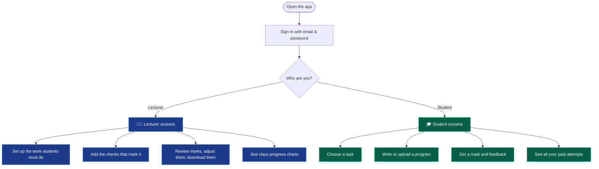
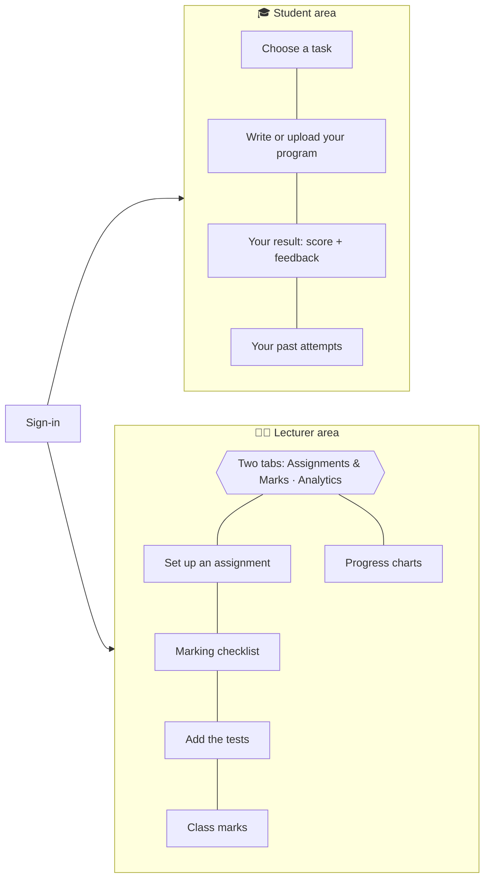
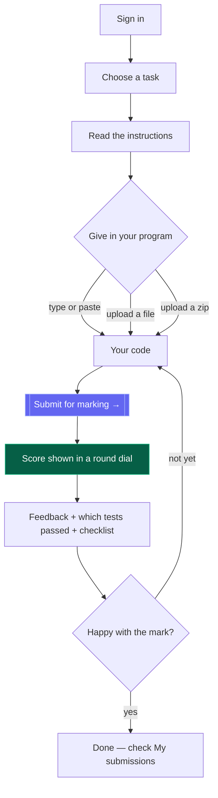
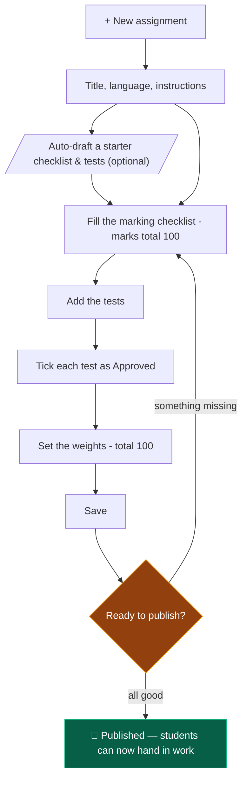
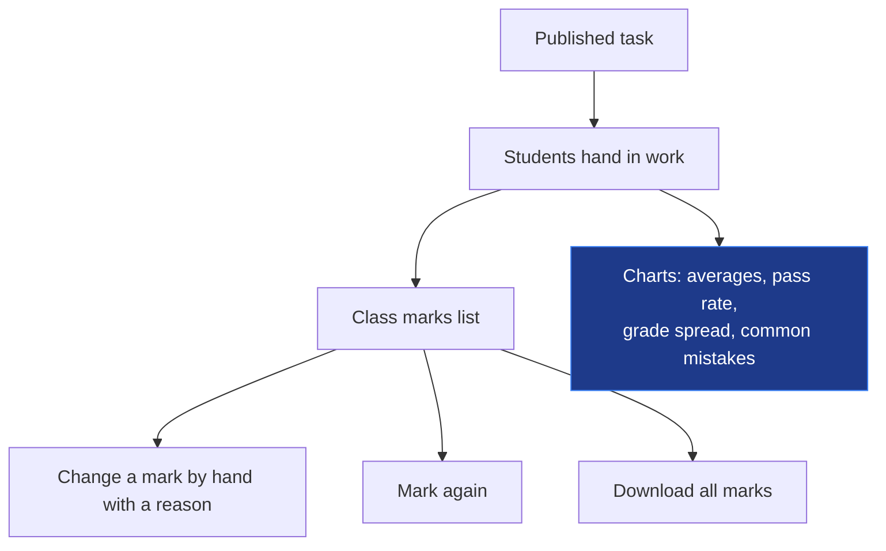
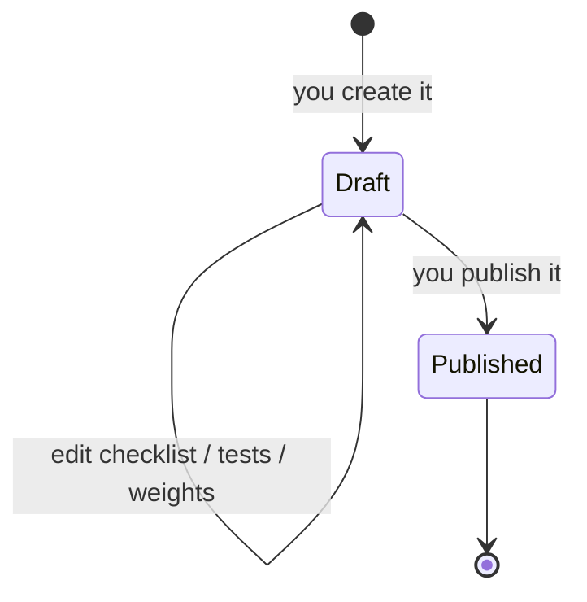
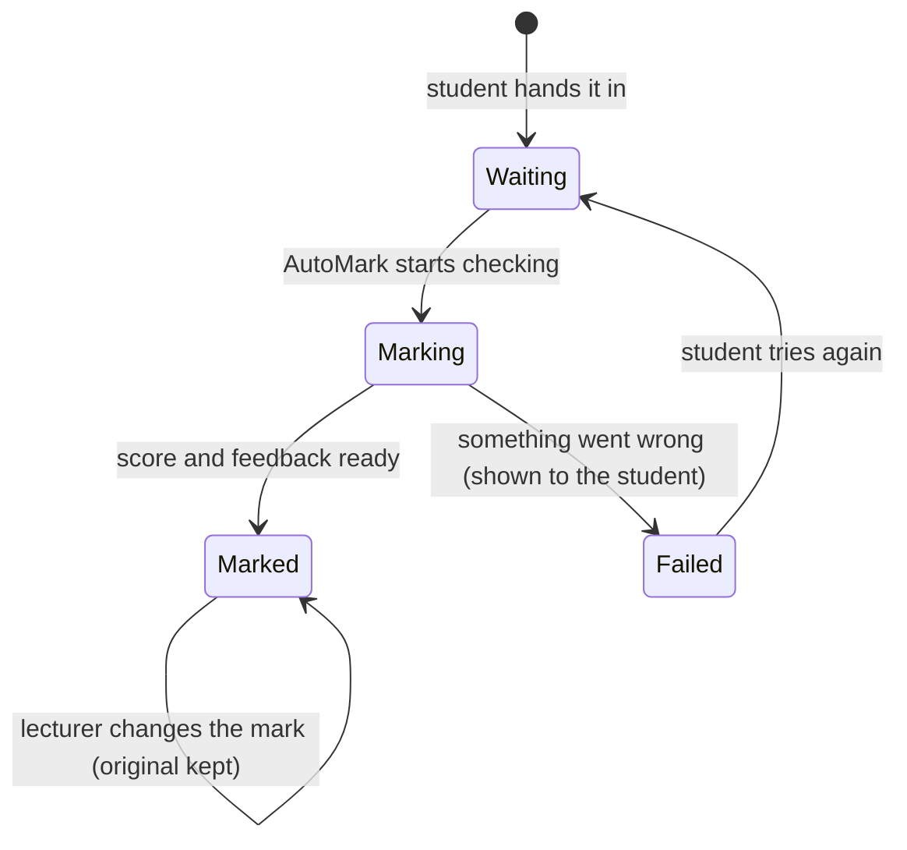
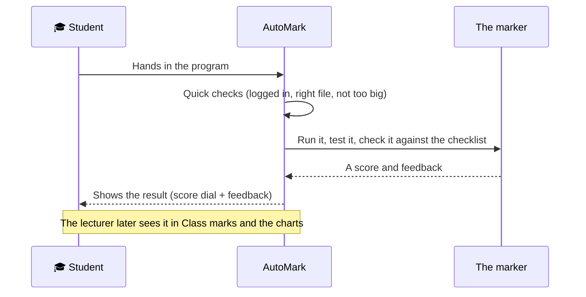

# AutoMark — how to use it (student & lecturer guide)

A simple walkthrough of what you can do in AutoMark and how to get around it,
whether you're a **lecturer** or a **student**. The pictures (diagrams) below
show the steps at a glance — they appear as drawings on GitHub or in VS Code.

- **Open the app:** <http://localhost:8000> (after someone has started it)
- **Try it with the demo logins** (password is **`password123`** for all):
  - Lecturer → `teacher@automark.test`
  - Students → `alice@class.test` … `erin@class.test`

In one line: **a student hands in a program, and AutoMark gives it a mark with
feedback — automatically.** A lecturer sets the work and reviews the results.

---

## 1. Everyone starts by signing in

When you open AutoMark you see a **sign-in page**. After you log in, the app
knows whether you're a **lecturer** or a **student** and shows you the right
screens — you can't wander into the wrong area by accident.

**Signing in / signing up**

- The login card has two tabs: **Sign in** and **Create student account**.
- *Create student account* is for **students** only. Lecturer accounts are set
  up for you (students can't make themselves a lecturer).
- Once you're in, the top bar shows your **name, your role, and a Sign-out
  button**.

---

## 2. The two main areas

---

## 3. For students — step by step

1. **Sign in** (or create a student account).
2. **Choose a task** on the left. Pick one from the list, and its instructions
   (the "brief") appear underneath. You only see tasks the lecturer has made
   available.
3. **Give in your program** on the right — any one of these:
   - **Type or paste** your code into the box, or
   - **Upload a file** (for example a `.py` or `.java` file), or
   - **Upload a zip file** if your program is made of several files.
4. Press **Submit for marking →**.
5. **See your result** just below. You get a **score out of 100** shown in a
   round dial, three progress bars (see the table further down), plain-language
   **feedback**, a list of each **test** and whether it passed, and a tick-list
   of what the task asked for.
6. **Try again as many times as you like.** Change your code and submit again —
   every attempt is saved under **"My submissions"**. Click any row there to
   see that result again.

### What your result is telling you

| What you see | What it means |
|--------------|---------------|
| **The round dial** | Your overall mark out of 100 (green = good, amber = okay, red = low). |
| **The three bars** | How you did on three things: does it **work** (tests), does it **do what was asked** (checklist), and is it **tidy** (style). |
| **Test list** | Each check the lecturer set, and whether your program passed it. |
| **Highlighted line** | If your program had a mistake that stopped it running, the exact line is highlighted so you can fix it. |
| **Checklist** | For each thing the task asked for: **done**, **partly done**, or **not done**, with the line where you did it. |
| **⚠ flagged for review** | Appears if it looks like the answers were typed in directly instead of really worked out — the lecturer will take a look. |

---

## 4. For lecturers — step by step

Use the two tabs at the top: **Assignments & Marks** and **Analytics**.

### A. Create a task and make it available to students

1. Click **+ New assignment**.
2. Enter a **title**, pick the **language** (Python or Java), and write the
   **instructions** students will read.
3. *(Optional)* Press **Auto-draft rubric & tests** to get a starter checklist
   and a sample test you can edit — a quick head start.
4. Fill in the **marking checklist** ("rubric"). Add each thing the task should
   do, and how many marks it's worth. **The marks must add up to 100.** For each
   item you can point to the tests that prove it — so a program that doesn't
   really do the job can't score for it.
5. Add the **tests** (the automatic checks):
   - **+ I/O test** — give an example input and the answer you expect back.
   - **+ JUnit test** (Java) — paste an automatic Java test.
   - **Tick "Approved"** on each test you want used for marking.
6. Set the **weights** — how much "does it work / does what was asked / tidy"
   each count toward the final mark. These must add up to 100 too.
7. Press **Save assignment**, then **Publish**.

> **Before you can publish:** there must be at least one test, **every** test
> must be ticked as approved, and the checklist marks and the weights must each
> add up to 100. If something's missing, AutoMark tells you what to fix.

### B. Review and manage marks

Open **Assignments & Marks**, pick the task, and the **Class marks** table lists
everyone who handed in work. For each one you can:

- **Override** — set a different mark by hand, with a reason. The original mark
  is kept, and the student sees your new one.
- **Regrade** — mark the submission again.
- **Export CSV** — download all the marks (opens in Excel/Sheets).
- A **⚠ review** tag shows any work AutoMark thinks might have been faked, so you
  can check it yourself.

### C. See how the class is doing

Switch to the **Analytics** tab for a dashboard:

- **Top numbers** — how many tasks, how many submissions, how many students, the
  **average mark**, and the **pass rate**.
- **Per-task charts** — the spread of grades (how many A's, B's, …) and the
  **things most students got wrong**, so you can see where to focus teaching.

---

## 5. The journey of a task and a submission

A **task** is only seen by students once you publish it:

A **submission** (one student handing in a program) goes through these stages:

---

## 6. What happens the moment a student clicks "Submit"

---

**Want more detail?** `README.md` explains how the marking works behind the
scenes, and `SETUP.md` explains how to install AutoMark from scratch.
