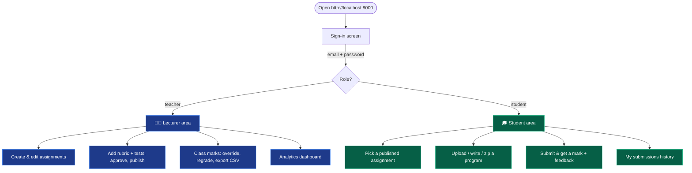
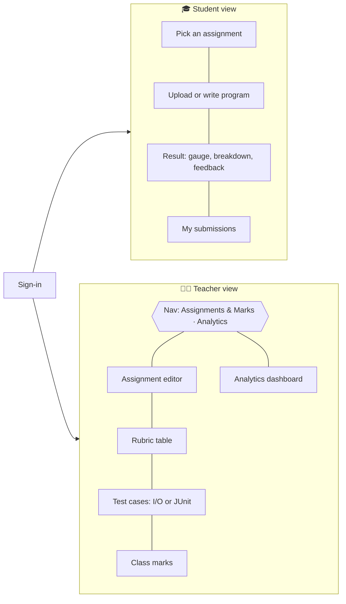
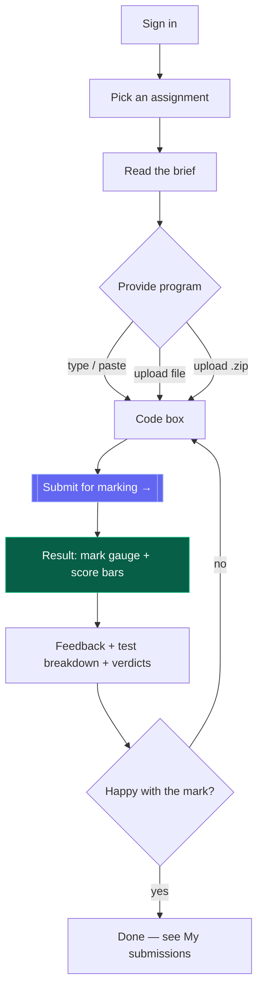
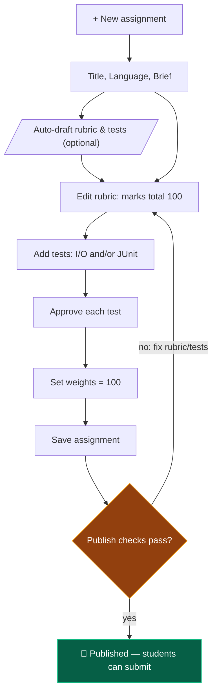
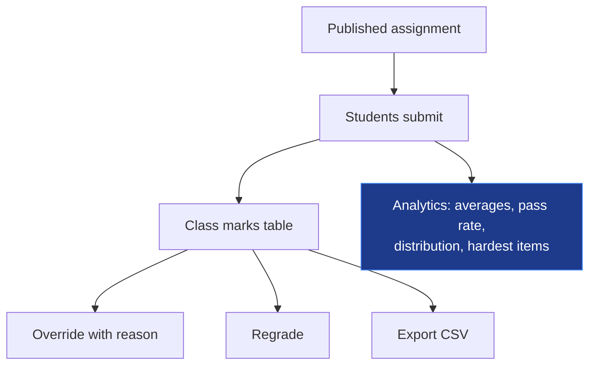
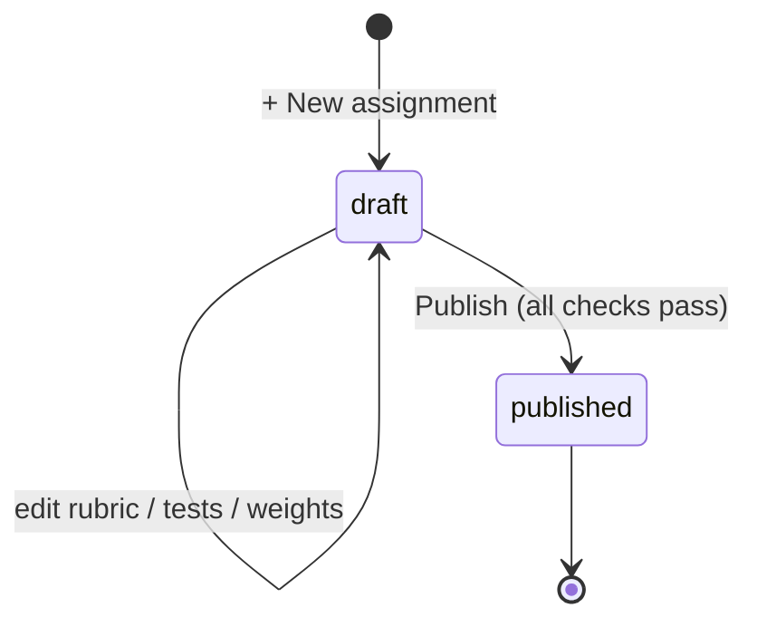
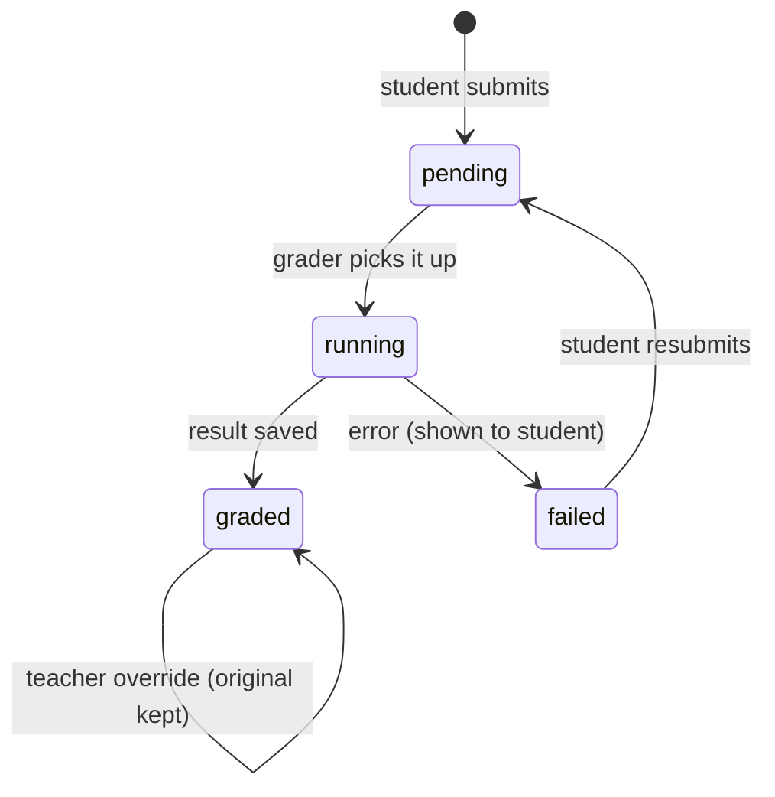
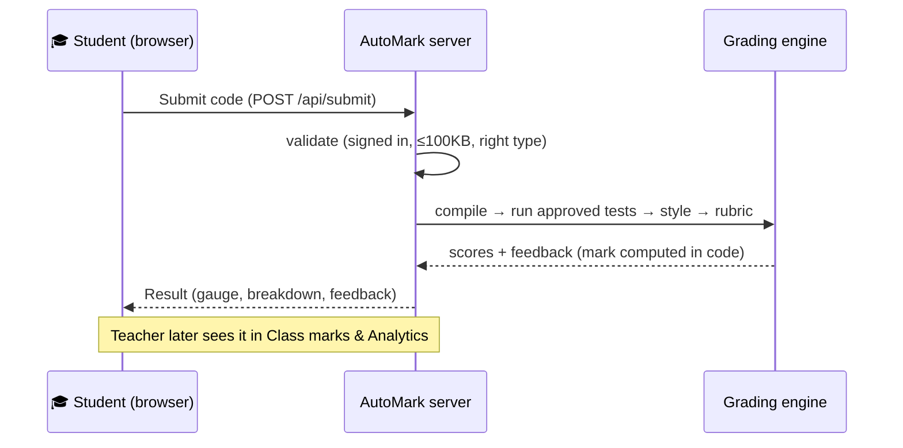

# AutoMark — flow & navigation guide

How to move around the app and do everything as a **Lecturer (teacher)** or a
**Student**. Diagrams render on GitHub / VS Code preview.

- App URL: <http://localhost:8000> (start with `python app.py`)
- Demo logins (password **`password123`**):
  - Lecturer → `teacher@automark.test`
  - Students → `alice@class.test` … `erin@class.test`

---

## 1. Who does what

Everyone lands on the **sign-in** screen. Your **role decides which screens you
see** — the app routes you automatically after login.

**Sign in / sign up**

- On the landing page, the card has two tabs: **Sign in** and **Create student
  account**.
- *Create student account* self-registers a **student** only (lecturer accounts
  are created by seeding/invite — SRS FR-02).
- After login the top bar shows your **avatar, name, role** and a **Sign out**
  button. Students never see the lecturer screens, and vice-versa.

---

## 2. Screen map

---

## 3. Student flow

### Step by step

1. **Sign in** (or *Create student account*).
2. **Pick an assignment** (left card) — choose from the **Assignment** dropdown;
   the **brief** appears below it. Only *published* assignments are listed.
3. **Provide your program** (right card), any one of:
   - **Write it** — type/paste into the **Code** box, or
   - **Upload a file** — *Choose File* → a `.py` / `.java` / `.txt`, or
   - **Upload a `.zip`** of several source files (multi-file projects).
4. Click **Submit for marking →**.
5. **Read your result** (appears below): the big **mark gauge**, the **Tests /
   Rubric / Style** score bars, **Feedback**, the **test breakdown**, and
   **requirement verdicts**. If your code didn't compile, the offending line is
   highlighted.
6. **Resubmit** anytime — just change the code and submit again. Every attempt is
   kept and listed under **My submissions** (click a row to reopen its result).

### What the result shows

| Element | Meaning |
|---------|---------|
| **Mark gauge** | Final mark /100 (green ≥70, amber ≥50, red below). |
| **Tests / Rubric / Style bars** | The three scores and their weights (default 60/25/15). |
| **Test breakdown** | Each test pass/fail; JUnit tests show **per-method** pills + **coverage**. |
| **Compile errors** | Your code with the **failing line highlighted**. |
| **Requirement verdicts** | Per rubric item: *met / partial / not met*, with line numbers. |
| **⚠ flagged for review** | Appears if the system suspects gaming (hard-coded answers). |

---

## 4. Lecturer (teacher) flow

Use the top-bar switch **Assignments & Marks ⟷ Analytics**.

### A. Create & publish an assignment

1. Click **+ New assignment**.
2. Fill in **Title**, choose **Language** (Python / Java), write the **Brief**.
3. *(Optional)* **Auto-draft rubric & tests** — generates starter rubric lines
   and a sample test to edit.
4. **Rubric** table — add requirements (**+ Add requirement**). Each has an
   **ID, text, Marks, Patterns**, and **Tests that prove it** (list the test IDs
   whose pass/fail decides the verdict — this is what catches wrong-for-the-task
   code). **Marks must total 100.**
5. **Test cases** table — add checks:
   - **+ I/O test** → give **stdin** and the **expected stdout** (±tolerance for
     numbers if set).
   - **+ JUnit test** (Java) → paste a **JUnit 5 test class**.
   - Tick **Approved** on each test you want used for marking.
6. Set the **Weights** (Tests / Rubric / Style) — must total 100.
7. **Save assignment**, then **Publish**.

> **Publish gate (FR-10):** at least one test, **every** test approved, rubric
> totalling 100, weights totalling 100 — otherwise publish is blocked with a
> message.

### B. Review & manage marks

In **Assignments & Marks**, pick the assignment → the **Class marks** table
lists every submission.

- **Override** — set a different final mark **with a reason**; the original mark
  is kept (audit) and the student sees the override.
- **Regrade** — re-run the grader for a submission.
- **Export CSV** — download all marks for the assignment.
- A **⚠ review** tag marks submissions the system flagged as possible gaming.

### C. Analytics

Switch to the **Analytics** tab:

- **Overview KPIs** — assignments, submissions, students, **average mark**,
  **pass rate**.
- **Per-assignment cards** — graded count, averages, **grade distribution**
  (A–F), and the **most-failed requirements** and **most-failed tests**, so you
  see exactly where the class struggles.

---

## 5. Lifecycles (state diagrams)

**Assignment** — only published assignments reach students:

**Submission** — each student upload moves through these states:

---

## 6. What happens when a student clicks Submit

For *how* grading actually works (hidden tests, Checkstyle, JUnit, coverage,
anti-gaming, the Docker sandbox), see **README.md**. For first-time setup from a
clone, see **SETUP.md**.
